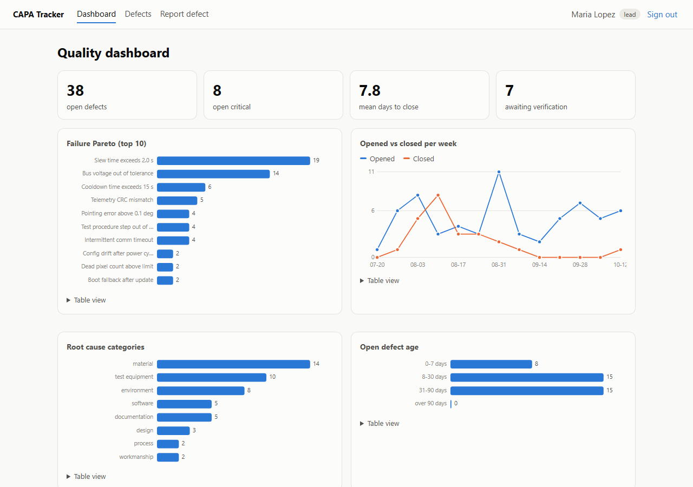
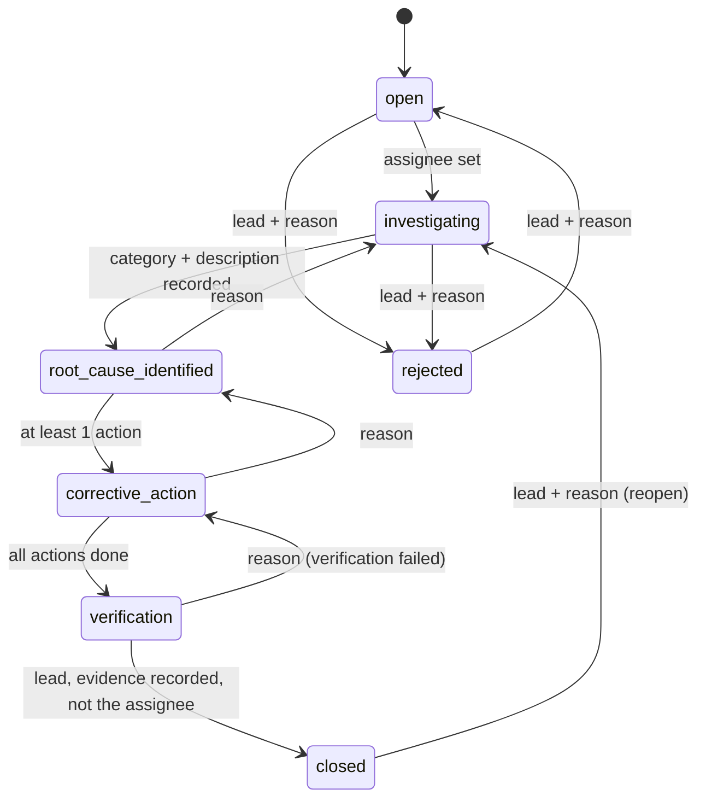
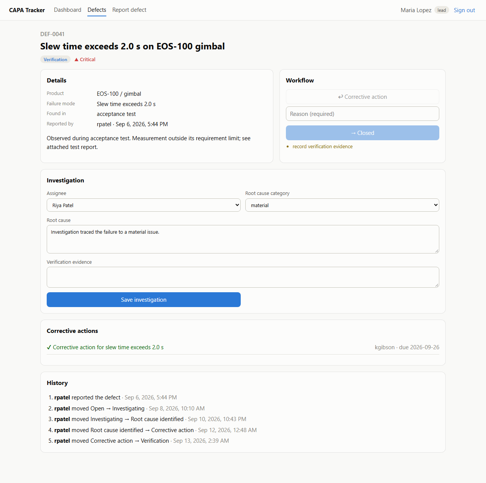

# defect-tracker

[](https://github.com/KyleEGibson/defect-tracker/actions/workflows/ci.yml)


A web app for tracking test failures through root cause and corrective action (CAPA), the loop that AS9100 shops have to run for every nonconformance.

The API enforces the workflow. Each step has prerequisites, a defect can only be closed by a lead who isn't the assignee, and every change goes into an append-only audit trail. Tests go from plain unit tests up through Playwright in a real browser and a JMeter load test.



## Workflow

The rules are all in `backend/app/workflow.py`, which has no DB or web code in it. The UI asks the API which moves are possible and shows why the rest are blocked:



## Stack
| Layer | Tech | Notes |
|---|---|---|
| Web | React 19 + TypeScript (Vite), React Router | filters kept in the URL, hand-rolled SVG charts with table views, light/dark |
| API | FastAPI, Pydantic 2, SQLAlchemy 2 | JWT login (OAuth2 password flow), 4 roles, scrypt hashing, per-field validation errors |
| Data | PostgreSQL 17 (SQLite for fast tests) | enums stored as strings so one schema works on both |
| Serving | nginx | serves the build and proxies `/api` (same origin, so no CORS), security headers |
| Ops | Docker Compose, GitHub Actions | one command starts db + api + web |

Roles go viewer (read only) < engineer (report and work defects) < lead (close, reject, reopen) < admin.

## Tests
| Layer | Tool | Count | Covers |
|---|---|---|---|
| Workflow rules | pytest | 15 | every transition and prerequisite, no HTTP or DB |
| API, auth, metrics | pytest + TestClient | 31 | login (no user enumeration), expired/forged/deactivated tokens, RBAC, validation, full lifecycle, separation of duties, audit trail, filters, paging, SQL injection probes, metrics. Runs on SQLite and PostgreSQL. |
| Web units | Vitest + Testing Library | 13 | API client (401 handling, error parsing), workflow panel, charts, list page filters |
| End to end | Playwright (Chromium) | 6 | real browser against the Docker stack: login, deep-link redirect, read-only viewer, report to close with a lead hand-off, reason required on send-back, dashboard |
| Load | JMeter | 2,020 requests | 20 users, 0 errors, p95 12-17 ms (budget 500 ms) through nginx, the API and PostgreSQL |

I mutation-tested two rules by hand (separation of duties and the role checks). Breaking either one fails tests.

### Bugs the tests found
| Found by | Bug | Fix |
|---|---|---|
| Playwright | Typing right after a workflow move got wiped when the background reload came back, so verification evidence saved as empty | form only resyncs from the server when there are no unsaved edits |
| oxlint | Clicking quickly between defects could show the previous defect's data | cancel the load when the defect changes |
| TypeScript build | untyped `catch` results in tests | typed as `ApiError` |

## Running it
```bash
docker compose up -d --build --wait          # http://localhost:8080
```
Demo users all use password `demo-pass-1234` (seeding is blocked in production): `mlopez` (lead), `kgibson` / `achen` / `rpatel` (engineers), `viewer`, `admin`.

Dev setup:
```bash
cd backend && pip install -e ".[dev]" && pytest
TRACKER_SEED_DEMO=true uvicorn app.main:create_app --factory --reload     # API on :8000
cd frontend && npm ci && npm run dev                                      # UI on :5173 (proxies /api)
cd e2e && npm ci && npx playwright install chromium && npx playwright test   # needs the compose stack
./loadtest/run.sh 20 25                                                    # needs the compose stack
```
OpenAPI docs are at http://localhost:8000/docs when the API runs on its own.

## Security notes
- Passwords are salted scrypt hashes, compared in constant time.
- Login gives the same error for an unknown user and a wrong password.
- In production the app won't start with the dev JWT secret or with demo seeding on.
- All queries go through SQLAlchemy parameters, and the tests include injection probes.
- The token is in `sessionStorage`, so closing the tab logs you out. Moving to an httpOnly cookie would be the next step against XSS.
